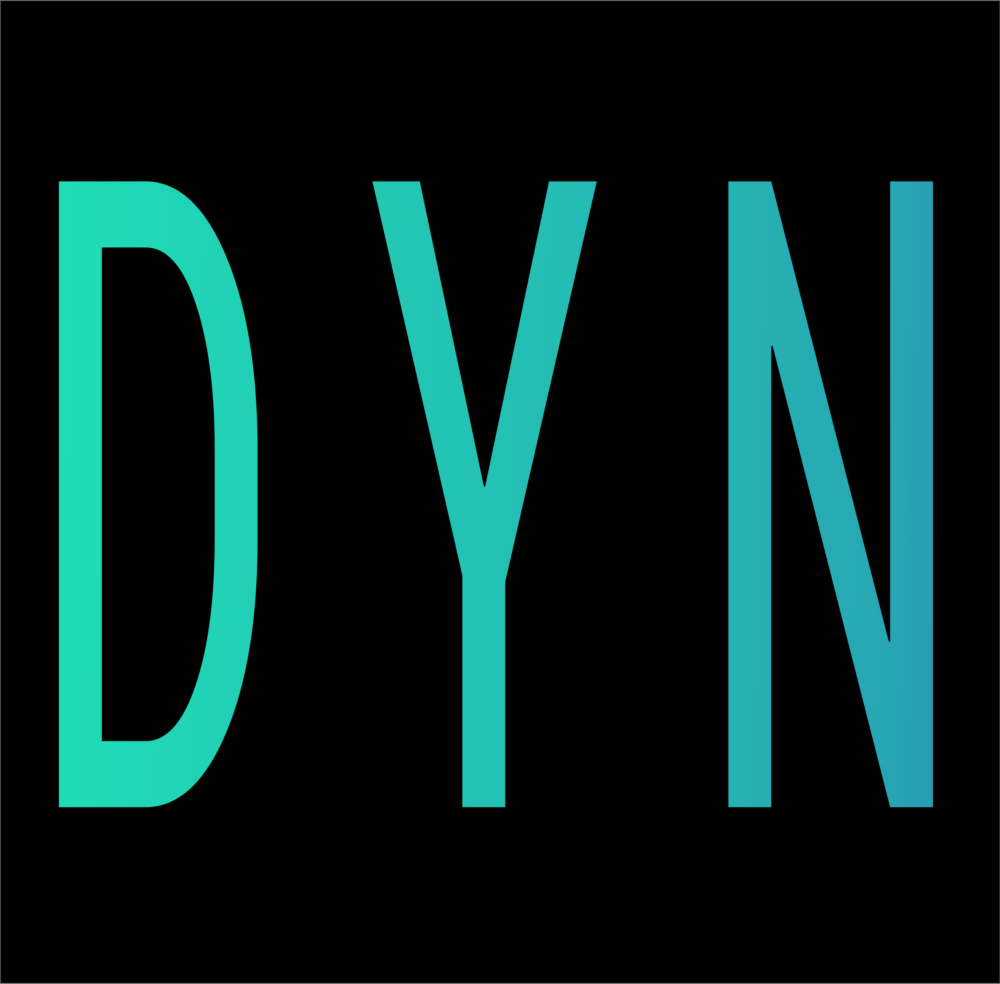

  

<h1 align="center">Dynamic</h1>

<h3 align="center">A simple cutting-edge yt-dlp GUI</h3>
<!--Badges appear here-->

  <b>Dynamic is a free open source yt-dlp GUI.</b> Download video and audio from YouTube, Instagram, TikTok, Reddit, SoundCloud +1000 more supported by the yt-dlp engine. Downloads stay on your computer, no files are sent or received by us. Licensed under GPL-3.0.

