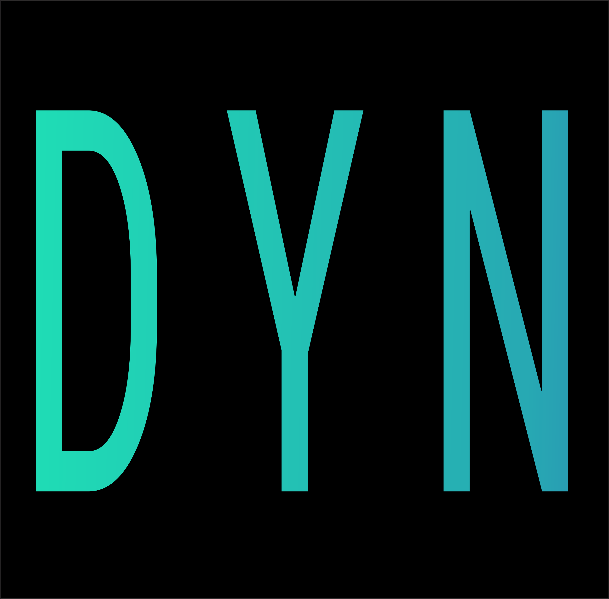
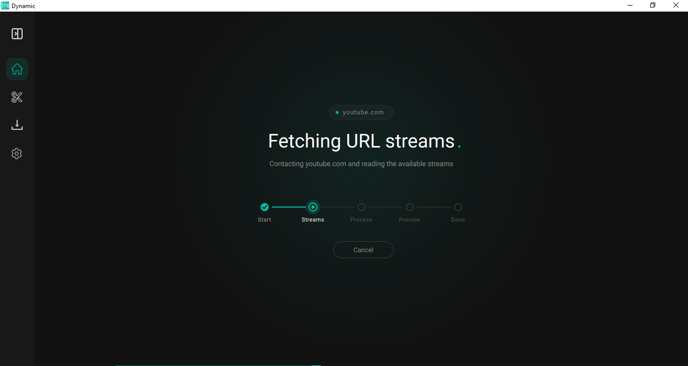
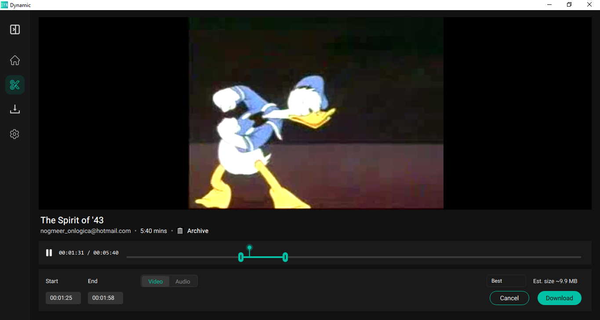

<p align="center">
  
</p>

<h1 align="center">Dynamic</h1>

<h3 align="center">A simple, cutting-edge yt-dlp GUI</h3>

<p align="center">
  <a href="https://github.com/Archiversvoid/Dynamic-yt-dlp-GUI/releases/latest"></a>
  <a href="https://github.com/Archiversvoid/Dynamic-yt-dlp-GUI/releases"></a>
  <a href="LICENSE"></a>
  
  <a href="https://github.com/Archiversvoid/Dynamic-yt-dlp-GUI/actions/workflows/build.yml"></a>
  <a href="https://discord.gg/D2x2MVmre"></a>
</p>

<p align="center">
  <b>Dynamic is a free, open-source yt-dlp GUI.</b> Download video and audio from YouTube, YouTube Music, Instagram, TikTok, Reddit, SoundCloud and 1000+ more sites supported by the yt-dlp engine. Licensed under GPL-3.0.
</p>

<p align="center">
  <a href="#installation">Install</a> ·
  <a href="#features">Features</a> ·
  <a href="#trimload-notes">TrimLoad notes</a> ·
  <a href="#security-and-antivirus-warnings">Security</a> ·
  <a href="#build-from-source">Build from source</a> ·
  <a href="#contributing">Contribute</a>
</p>

---

## Screenshots

<p align="center">
  <br/>
  <sub><b>Home</b> – paste a link and Dynamic reads the available streams.</sub>
</p>

<p align="center">
  <br/>
  <sub><b>TrimLoad</b> – preview the video, set a start and end, and download only that part.</sub>
</p>

## Features

- **Video or audio** – choose a resolution for video, or switch to audio and pick an MP3 bitrate. An estimated file size is shown before you download.
- **Precision clip trimming (TrimLoad)** – watch a preview, pick the exact start and end, and download only that segment instead of the whole video.
- **Downloads tab** – live progress, speed, ETA and thumbnails for every download. If something fails, you can see the reason why in the error log.
- **Dark and light themes** – follows Windows by default, or choose one in Settings.
- **Stays up to date** – one place (Settings > Update) keeps yt-dlp, ffmpeg and Dynamic itself current. Updates replace only the files that changed, and yt-dlp/ffmpeg can update on a schedule.
- **Lives in the tray** – closing the window keeps Dynamic running quietly in the system tray; opening it again just brings it back.
- **First-run guide** – a short setup wizard walks you through the terms and downloads the two helper programs for you.
- **No ads, accounts or analytics.**

## Installation

### Windows installer (recommended)

1. Open the [**latest release**](https://github.com/Archiversvoid/Dynamic-yt-dlp-GUI/releases/latest) and download `Dynamic-Setup-1.1.0.exe`.
2. Run it. **Windows or your antivirus may warn you** because the app is not code-signed – see [Security and antivirus warnings](#security-and-antivirus-warnings) for what to do.
3. Leave *Launch Dynamic* ticked on the last page. The setup guide opens, asks you to accept the terms, and offers to download **yt-dlp** and **ffmpeg** (you can skip this and do it later from the Home page or Settings).

**Requirements:** Windows 10 or 11 (64-bit) and an internet connection for the first setup. No administrator rights are needed.

By default Dynamic installs to `%LOCALAPPDATA%\Programs\Dynamic`; you can pick another folder in the installer.

### Updating

Dynamic checks for new releases by itself and shows a notification. Press **Update** and it downloads the new version, swaps in only the files that changed, and offers to restart. You can also check manually under **Settings > Update > Dynamic**. If you press *Remind me later*, the notification stays quiet for 24 hours.

### Uninstalling

Use **Windows Settings > Apps > Installed apps > Dynamic > Uninstall**. The uninstaller asks whether to also delete your settings and download history; your downloaded files are never touched.

## Quick start

**To save a whole video or song (Home):**

1. On the **Home** page, paste a link and press Enter. Dynamic reads the site and shows a card for the video.
2. Choose **Video** or **Audio**, pick a quality or bitrate from the list, and press **Download**.
3. Follow it in the **Downloads** tab.

**To save just a clip (TrimLoad):**

1. Open the **TrimLoad** tab (the scissors icon), paste a link into its own box and press Enter.
2. Watch the preview, then drag the handles or type the **Start** and **End** times.
3. Choose **Video** or **Audio**, pick a quality, and press **Download**.

If yt-dlp or ffmpeg is missing, a notification on the Home and TrimLoad pages lets you download it with one click, or point Dynamic at a copy you already have (**From disk...**).

## How Home works

Home is Dynamic's quick downloader: paste a link, pick what you want, press **Download**. It always saves the **whole** video or audio track, so it needs no preview and is the most dependable way to get something. (For a clip, use [TrimLoad](#how-trimload-works).)

### What you see

Paste a link and press Enter. A progress screen shows Dynamic reading the site, then a card appears with the thumbnail, title, channel, site and length, a **Video / Audio** switch, one list of qualities, and a **Download** button. Pressing it hands the job to the **Downloads** tab.

### The quality and bitrate lists are not hard-coded

Many downloaders show the same fixed list (1080p, 720p, 320 kbps...) whatever you paste. Dynamic builds its lists from what the site actually offers for **that exact link**:

- **Video** – one entry per resolution the site has, highest first. A frame rate is added above 30 fps (for example `1080p 60fps`) and an estimated file size is shown next to each entry. A video that only exists in 480p shows 480p, never a 4K option that wouldn't work. Storyboard thumbnails are ignored. If a site doesn't report a resolution you get *Default Video*, and if it reports no usable streams at all there is a single *Best quality* entry.
- **Audio** – one entry per audio bitrate the site offers, highest first (for example `MP3 160kbps`), with an estimated size. Unknown bitrates show as *Best Audio*. Only when a site reports no audio streams at all does Dynamic fall back to a standard ladder (320, 256, 192, 128, 96 and 64 kbps).
- **Audio-only sites** such as SoundCloud skip the video list entirely.

### What your choice does

- A **video quality** tells yt-dlp to fetch exactly that stream plus the best audio, and merges them into one `.mp4`.
- An **audio bitrate** converts the audio to MP3 at the closest standard MP3 bitrate (a 130 kbps source is encoded at 128).
- **Live and scheduled streams** are turned away with a message.

### Home or TrimLoad?

| | Home | TrimLoad |
| --- | --- | --- |
| Best for | A whole video or song | Just a part of a video |
| Needs a preview | No | Yes |
| Most dependable | Yes | Depends on the site (see the [notes](#trimload-notes)) |

## How TrimLoad works

TrimLoad is a simple video player with live preview capabilities for audio and video sites, but a fair bit happens underneath. Here is how it works behind the scenes.


### 1. Reading the streams

When you paste a link into TrimLoad's own box (*Enter link to trim...*) and press Enter, Dynamic asks **yt-dlp** about the video: title, uploader, length, thumbnail and, most importantly, the list of **streams** the site offers. **Nothing is downloaded at this point.** A site usually offers many streams: several resolutions, video-only and audio-only versions, and sometimes a combined one. Live and scheduled streams are turned away here with a message, because they have no fixed length to trim.

The progress screen you see (*Start > Streams > Process > Preview > Done*) is exactly these steps.

### 2. Picking a stream for the preview

A player can open only **one** address, but many sites keep video and audio apart. So Dynamic tries to choose the single stream that is most likely to play directly, preferring formats that play reliably (usually H.264 MP4), and hands it to the player.

That is why the preview can sometimes be silent (only a video stream was playable) or show **Preview not available** (nothing playable was offered). It is also why the preview is not always the same quality as the file you download.

### 3. The preview player

The preview streams **straight from the website**, so nothing is saved to your disk while you watch. In the installed app it uses Qt's multimedia player with Windows' built-in media engine, which keeps Dynamic small; the trade-off is the codec limits described in the [TrimLoad notes](#trimload-notes).

The two handles on the timeline and the **Start** / **End** boxes are kept in sync: drag a handle and the box updates, type a time and the handle moves. Some sites' stream links expire after a few hours, so if a video has been open for a long time and the preview stops, paste the link again.

### 4. Video, audio and the size estimate

The **Video / Audio** switch changes what the quality box offers: resolutions for video, **MP3 bitrates** for audio. Dynamic remembers your choice for each mode.

The **estimated size** is worked out from the quality you picked and the length of your selection, which is why it changes as you drag the handles. It is only an estimate; the final size depends on how the site encoded the video.

### 5. What happens when you press Download

Dynamic does **not** download the whole video and cut it afterwards. Instead:

1. **yt-dlp downloads only your section** (`--download-sections`), in parallel pieces where the site allows it.
2. **ffmpeg makes the cut frame-accurate.** Video can only be cut cleanly at certain "keyframes", so around each cut point a few seconds are re-encoded and the rest is copied untouched (`--force-keyframes-at-cuts`). You get precise cuts without re-encoding the whole clip.
3. **Video:** the best video and audio for your chosen quality are merged into one `.mp4`. **Audio:** the best audio is converted to MP3 at your chosen bitrate, with the cover art and tags embedded.
4. In the installed app the download is done in a temporary working folder inside your download folder and moved into place when it finishes, under a free name (`Title.mp4`, then `Title (1).mp4`, and so on), so nothing is ever overwritten.

This is also why **ffmpeg is required** for trimming, and why a download can succeed even when the preview can't.

### Under the hood

- **Loaded on demand.** The preview engine is heavy, so TrimLoad is built the first time you open it (you may briefly see *Loading TrimLoad…*). Dynamic warms the needed files up in the background right after launch, so it is usually instant.
- **One engine for everything.** The Home page, TrimLoad and the Downloads tab all use the same yt-dlp and ffmpeg that **Settings > Update** keeps current. The installed app runs `yt-dlp.exe` from its `bin` folder.

## TrimLoad notes

> [!NOTE]
> **TrimLoad is not 100% perfect.** The preview depends on what each website allows, so a few things can behave differently from site to site.

- **Some sites don't allow streaming with audio.** The preview may play without sound even though the finished download has it.
- **Some videos show "Preview not available".** The site may not offer a stream that can be played directly. Downloading usually still works – you just can't scrub through the preview first.
- **Some formats can't be previewed.** The preview uses Windows' built-in media engine, so a few codecs (for example VP9/AV1) may not play even when downloading them works fine.
- **Live and scheduled streams are not supported** in TrimLoad.
- **The estimated size is only an estimate.** The real file can differ a little.
- Trimming needs **ffmpeg**.

If a site won't preview, you can still save the whole video from the **Home** page, which needs no preview.

If a site behaves badly, please [open an issue](https://github.com/Archiversvoid/Dynamic-yt-dlp-GUI/issues) with the link (if it's public) and what you saw.

## Security and antivirus warnings

> [!WARNING]
> **Dynamic is not code-signed.** Code-signing certificates cost money, and a brand-new unsigned program has no reputation yet. Because of that, Windows SmartScreen or your antivirus can warn about the installer or even block it. This is a **false positive**, but you don't have to take my word for it – see below.

**What you might see**

- **Windows SmartScreen – "Windows protected your PC".** Click **More info**, then **Run anyway**.
- **Avast / other antivirus – "checking if the file contains malware" or a quarantine.** Let the scan finish. If the file is quarantined, restore it and add an exception, or submit it to your antivirus vendor as a false positive. The first launch after an update can be scanned again because the file is new.

**How to check for yourself**

- **The source is public.** Everything in this repository is what gets built – read it, or build it yourself (see [Build from source](#build-from-source)).
- **Releases are built automatically by GitHub Actions** from this repository, not on a private machine. You can read the [workflow](.github/workflows/build.yml) and see every build in the *Actions* tab.
- **Compare checksums.** Each release has a `.sha256.txt` file. In PowerShell, run the following in the folder you downloaded to, and compare the result with the file:

  ```powershell
  Get-FileHash .\Dynamic-Setup-x.y.z.exe -Algorithm SHA256
  ```

## Where Dynamic keeps its files

| What | Where |
| --- | --- |
| The app | `%LOCALAPPDATA%\Programs\Dynamic` (or the folder you chose) |
| yt-dlp and ffmpeg | the `bin` folder inside the app folder |
| Settings, download list, cache, logs | `%APPDATA%\Dynamic` |
| Your downloads | your Windows **Downloads** folder (change it in Settings) |

## Build from source

You only need this if you want to run or change the code. Normal users should use the [installer](#installation).

### Prerequisites

- **Windows 10 or 11**
- **[Python 3.12](https://www.python.org/downloads/)** (the version releases are built with)
- **[Inno Setup 6.3+](https://jrsoftware.org/isinfo.php)** – only if you want to build the installer

### Run it

Run this command to clone the repo *developers only*.

```powershell
# 1. Download a copy of the code and go into the folder
git clone https://github.com/Archiversvoid/Dynamic-yt-dlp-GUI.git
cd Dynamic-yt-dlp-GUI

# 2. Create an isolated Python environment and switch it on
python -m venv .venv
.venv\Scripts\activate

# 3. Install what the app needs (yt-dlp is used directly when running from source)
pip install -r requirements.txt
pip install yt-dlp

# 4. Start it
python launcher.py
```

ffmpeg: put `ffmpeg.exe` and `ffprobe.exe` in a folder named `bin` next to `launcher.py` (or have them on your `PATH`), or let the in-app notification download them.

### Build the installer

```powershell
python build.py            # PyInstaller build + update package + installer
python build.py --help     # (see the top of build.py for all options)
```

The installer ends up in `Output\` and the in-app update package in `dist\`.

### Project structure

```text
launcher.py        entry point: splash screen, then starts the app
main.py            the main window
setup_wizard.py    first-run setup guide
theme.py           dark/light theme engine
src/core/          downloading, yt-dlp/ffmpeg handling, updates
src/ui/            interface: tabs, TrimLoad, components
icons/  assets/    images
build.py           builds the app, the update package and the installer
Dynamic.spec       PyInstaller configuration
Dynamic.iss        Inno Setup (installer) script
.github/workflows/ automatic release builds
```

<details>
<summary><b>For maintainers: how releases are made</b></summary>

Releases are built by the **Build release** workflow – the version always comes from what you type, never from the file.

- **From the Actions tab:** *Build release > Run workflow*, type a version such as `1.2.0`. It builds the installer and the in-app update package and leaves them on a **draft** release. Open the draft, write the notes, and press *Publish release*.
- **From the Releases page:** create a release with a **new tag** (`v1.2.0` or `1.2.0`) and publish it. Creating the tag starts the build, which attaches the files to your release.
- Leaving the version empty makes a test build (files are kept on the run, no release is made).
- The first release (1.1.0) ships the installer only; later releases also include `Dynamic-x.y.z-update.zip`, which the in-app updater downloads.

</details>

## Contributing

Bug reports, ideas and pull requests are welcome.

- **Found a bug or want a feature?** [Open an issue](https://github.com/Archiversvoid/Dynamic-yt-dlp-GUI/issues). Please include your Windows version, the Dynamic version (Settings > Update), what you expected, and what happened. Logs are in `%APPDATA%\Dynamic\logs`.
- **Want to change the code?**
  1. **Fork** the repository (the *Fork* button, top right).
  2. **Clone your fork** and make a branch:
     ```powershell
     git clone https://github.com/<your-username>/Dynamic-yt-dlp-GUI.git
     cd Dynamic-yt-dlp-GUI
     git checkout -b my-change
     ```
  3. Make your change, then save and upload it:
     ```powershell
     git add .
     git commit -m "Describe what you changed"
     git push origin my-change
     ```
  4. On GitHub, press **Compare & pull request**.

## Community

- 💬 [Discord](https://discord.gg/D2x2MVmre)
- 👽 [Reddit – u/Archivers_void](https://reddit.com/users/Archivers_void)
- 🐛 [Bugs](https://github.com/Archiversvoid/Dynamic-yt-dlp-GUI/issues)
- ✨ [Ideas](https://github.com/Archiversvoid/Dynamic-yt-dlp-GUI/discussions)

## Disclaimer

Dynamic is a graphical front end for [yt-dlp](https://github.com/yt-dlp/yt-dlp). It does not host, provide or endorse any content. You are responsible for following the terms of service of the sites you download from and the copyright laws that apply to you. Dynamic is not affiliated with yt-dlp, FFmpeg, or any website it can download from.

## License and credits

Dynamic is licensed under the **GNU General Public License v3.0** – see [LICENSE](LICENSE).

Built with the help of these projects (downloaded separately; not bundled in the app):

- [yt-dlp](https://github.com/yt-dlp/yt-dlp) – the download engine
- [FFmpeg](https://ffmpeg.org/) – merging, trimming and converting (Windows builds by [gyan.dev](https://www.gyan.dev/ffmpeg/builds/))
- [Qt for Python (PySide6)](https://doc.qt.io/qtforpython-6/) – the interface
- [PyInstaller](https://pyinstaller.org/) and [Inno Setup](https://jrsoftware.org/isinfo.php) – packaging and the installer
